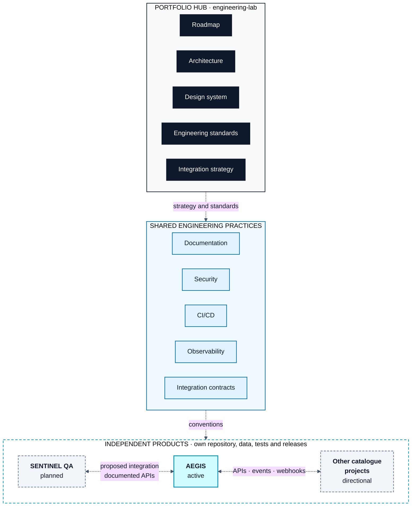

<div align="center">

# ENGINEERING LAB

### SOFTWARE · SYSTEMS · INTELLIGENCE · RESEARCH

**An independent engineering portfolio exploring how reliable software, intelligent systems, and foundational computing technologies are designed, built, tested, and connected.**

<br/>

<p align="center">
  
  
  
  
</p>

[**About**](#about) · [**Portfolio**](#portfolio-at-a-glance) · [**Current Work**](#current-work) · [**Approach**](#engineering-approach) · [**Architecture**](#architecture) · [**Documentation**](#documentation) · [**Status**](#project-status)

</div>

---

## Contents

- [About](#about)
- [Portfolio at a Glance](#portfolio-at-a-glance)
- [Current Work](#current-work)
- [Engineering Approach](#engineering-approach)
- [Architecture](#architecture)
- [Design Principles](#design-principles)
- [Technology Philosophy](#technology-philosophy)
- [Documentation](#documentation)
- [Project Status](#project-status)
- [Repository Structure](#repository-structure)
- [Working Cadence](#working-cadence)
- [Contributing and Feedback](#contributing-and-feedback)
- [Status and Disclaimer](#status-and-disclaimer)

---

## About

ENGINEERING LAB is a portfolio of independent software products and research projects. It brings together practical application engineering, cybersecurity, quality engineering, distributed systems, artificial intelligence, and computer science foundations.

The goal is not to collect repositories or technologies. The goal is to develop a small number of technically substantial systems, understand their internals, validate their behaviour, and communicate the engineering decisions behind them.

Each product has its own purpose, repository, architecture, and release lifecycle. **This repository is the portfolio hub**: it documents the shared direction, engineering principles, design conventions, and integration strategy.

---

## Portfolio at a Glance

| Area | Projects | Current state |
|---|---|---|
| **Cybersecurity** | AEGIS | Active development |
| **Quality engineering** | SENTINEL QA, QUANTUM TEST LAB, SENTINEL CODE | SENTINEL QA planned; others directional |
| **Enterprise applications and automation** | MERIDIAN, ORBIT, FLOWSTATE, APEX, VERITAS | Directional catalogue |
| **Computer science foundations** | FORGE, NEXUS, GITFORGE | Directional catalogue |
| **Distributed systems and infrastructure** | CHRONOS, OBSERVA, ATLAS, NEBULA | Directional catalogue |
| **AI and data platforms** | CORTEX, ORACLE, SYNAPSE | Directional catalogue |
| **Computational and specialist systems** | VELOCITY, HELIOS, AURORA, POLARIS, QUANTUM, PHOENIX | Directional catalogue |

> [!NOTE]
> The catalogue is a long-term direction, not a claim that every listed project has been implemented. See [ROADMAP.md](ROADMAP.md) for priorities and current statuses.

---

## Current Work

### AEGIS: Security detection and response

AEGIS is the existing flagship project: an educational security platform built around event ingestion, detection rules, alert management, and a web dashboard.

- **Backend foundation:** Python and FastAPI
- **Persistence:** SQLite in the current development setup
- **Focus:** security event handling, detection workflows, alert lifecycle, and operational visibility
- **Status:** active development; the consolidated capability, verification and limitation record is maintained in ENGINEERING LAB at [docs/projects/AEGIS.md](docs/projects/AEGIS.md)

| | |
|---|---|
| **Portfolio record** | [AEGIS project record](docs/projects/AEGIS.md): consolidated scope, technical snapshot, capability inventory, verification evidence and remaining work |
| **Repository** | [aegis-security-platform](https://github.com/Nomusa990822/aegis-security-platform) |

### SENTINEL QA: Quality engineering platform

SENTINEL QA is the next major planned product. It will explore maintainable automated testing across web interfaces, APIs, and performance workloads, with reproducible local and CI execution.

- **Candidate technologies:** Java, Maven, Selenium, JUnit or TestNG, REST Assured, JMeter, and GitHub Actions
- **First proposed integration:** test AEGIS through documented APIs and an isolated test environment
- **Status:** planned; discovery and design must precede implementation

---

## Engineering Approach

Every substantial project follows a disciplined lifecycle:

```mermaid
%%{init: {
  "theme": "base",
  "themeVariables": {
    "fontFamily": "Inter, Segoe UI, Helvetica, Arial, sans-serif",
    "primaryTextColor": "#0f172a",
    "lineColor": "#475569"
  },
  "flowchart": { "curve": "basis", "nodeSpacing": 26, "rankSpacing": 40, "htmlLabels": true }
}}%%
flowchart LR
    A["<b>1 · Understand</b><br/>problem and users"] --> B["<b>2 · Define</b><br/>scope, risks,<br/>acceptance criteria"]
    B --> C["<b>3 · Design</b><br/>architecture and<br/>decision records"]
    C --> D["<b>4 · Implement</b><br/>small vertical slices"]
    D --> E["<b>5 · Verify</b><br/>automated tests and<br/>reproducible checks"]
    E --> F["<b>6 · Review</b><br/>security, accessibility,<br/>reliability, maintainability"]
    F --> G["<b>7 · Document</b><br/>setup, operation,<br/>limits, evidence"]
    G --> H{"<b>Quality gates<br/>met?</b>"}
    H -->|"Yes"| I(["<b>8 · Release</b>"])
    H -->|"Not yet"| D

    classDef step  fill:#e0f2fe,stroke:#0369a1,stroke-width:1.5px,color:#0f172a;
    classDef gate  fill:#cffafe,stroke:#0891b2,stroke-width:2px,color:#0f172a;
    classDef final fill:#0f172a,stroke:#0f172a,color:#ffffff;
    class A,B,C,D,E,F,G step;
    class H gate;
    class I final;
    linkStyle default stroke:#475569,stroke-width:1.6px
```



1. Understand the problem and intended users.
2. Define scope, requirements, risks, and acceptance criteria.
3. Design the architecture and record consequential decisions.
4. Implement in small, coherent vertical slices.
5. Verify behaviour with automated tests and reproducible checks.
6. Review security, accessibility, reliability, and maintainability.
7. Document setup, operation, limitations, and evidence.
8. Release only when the defined quality gates are met.

> [!IMPORTANT]
> Engineering claims must be supported by evidence. Performance figures, test coverage, reliability, and security outcomes are measured and reported rather than assumed.

---

## Architecture

ENGINEERING LAB uses three logical layers:

| Layer | Role |
|---|---|
| **Independent products** | Each product owns its application logic, data, tests, and release lifecycle |
| **Shared engineering practices** | Common conventions for documentation, security, CI/CD, observability, design principles, and integration contracts |
| **Portfolio hub** | This repository, which provides navigation, strategy, standards, and project-level context |



Products communicate through explicit, documented interfaces such as APIs, events, webhooks, or controlled data exchange. They do not share internal database tables by default.

> [!NOTE]
> Integrations described in the portfolio documents are proposals until implemented and verified. AEGIS remains an independent product with its own identity; the shared design system does not mandate a redesign of it.

---

## Design Principles

- Dark and light themes are both supported in the shared design direction; **dark is the default**.
- Interfaces prioritise clarity, hierarchy, responsive behaviour, keyboard accessibility, and readable contrast.
- Products may use distinct accent colours while sharing a restrained visual foundation.
- Product-specific identity and usability take precedence over forced uniformity.

> [!NOTE]
> The design system is currently a specification. It is not a claim that a shared component library or theme switch has already been implemented across the products.

---

## Technology Philosophy

Technology is selected to serve the engineering problem, not to maximise the number of tools in a README.

The portfolio may use Python, Java, C#, JavaScript/TypeScript, Go, C/C++, Rust, SQL, and supporting technologies such as Docker, message brokers, and orchestration platforms where justified by project requirements.

**Not every project needs every technology. Complexity must earn its place.**

---

## Documentation

| Document | Purpose |
|---|---|
| [ROADMAP.md](ROADMAP.md) | Project catalogue, priorities, phases, milestones, and status definitions |
| [ARCHITECTURE.md](ARCHITECTURE.md) | Portfolio layers, product boundaries, data ownership, and system evolution |
| [DESIGN-SYSTEM.md](DESIGN-SYSTEM.md) | Shared visual foundations, themes, accessibility, and design conventions |
| [ENGINEERING-STANDARDS.md](ENGINEERING-STANDARDS.md) | Development lifecycle, code quality, testing, security, and definition of done |
| [INTEGRATION-STRATEGY.md](INTEGRATION-STRATEGY.md) | API, event, webhook, security, and integration contract guidance |
| [Project status dashboard](docs/PROJECT-STATUS.md) | Evidence-based status, milestones, blockers, and next actions |
| [AEGIS project record](docs/projects/AEGIS.md) | Consolidated AEGIS scope, technical snapshot, capability inventory, verification ledger, limitations, and next actions |
| [Project catalogue](docs/project-catalogue/README.md) | Scope and direction of the portfolio projects |
| [ADR index](docs/decisions/README.md) | Architecture decision process and accepted decisions |
| [Documentation templates](docs/templates/README.md) | Reusable project README, technical specification, feature tracker, and development log templates |
| [Development log](docs/development-log/README.md) | Portfolio-level work history and evidence conventions |

> [!IMPORTANT]
> Product source code and product-runtime documentation belong in each independent product repository. ENGINEERING LAB maintains the portfolio-level AEGIS record at [docs/projects/AEGIS.md](docs/projects/AEGIS.md); do not place this portfolio record or its progress reports in the AEGIS product repository.

---

## Project Status

Statuses are evidence-based and use a consistent portfolio vocabulary:

| Stage | Meaning in the portfolio vocabulary |
|---|---|
| `Proposed` · `Planned` · `Discovery` | Early stages: idea, committed plan, investigation and design |
| `In Progress` · `In Review` | Active implementation and review |
| `Complete` · `Maintained` | Delivered milestone, and ongoing upkeep |
| `Blocked` · `Paused` · `Archived` | Work that is stalled, deliberately stopped, or retired |

A **Complete** status applies to a defined milestone, not automatically to an entire product. A working prototype is not automatically production-ready.

See the [project status dashboard](docs/PROJECT-STATUS.md) for current portfolio status, evidence, blockers, and next actions.

---

## Repository Structure

This repository is the portfolio hub, not a monorepo containing every product.

```text
engineering-lab/
├── README.md
├── ROADMAP.md
├── ARCHITECTURE.md
├── DESIGN-SYSTEM.md
├── ENGINEERING-STANDARDS.md
├── INTEGRATION-STRATEGY.md
└── docs/
    ├── PROJECT-STATUS.md
    ├── decisions/
    │   ├── README.md
    │   ├── ADR-TEMPLATE.md
    │   └── ADR-*.md
    ├── development-log/
    │   ├── README.md
    │   └── YYYY-MM-DD.md
    ├── project-catalogue/
    │   └── README.md
    ├── projects/
    │   └── AEGIS.md
    └── templates/
        ├── README.md
        ├── PROJECT-README-TEMPLATE.md
        ├── TECHNICAL-SPECIFICATION-TEMPLATE.md
        ├── FEATURE-TRACKER-TEMPLATE.md
        └── DEVELOPMENT-LOG-TEMPLATE.md
```

Each product is maintained in its own repository when implementation begins.

---

## Working Cadence

The indicative build programme targets **five to eight focused hours per week**. Work is planned in achievable milestones, with learning, implementation, testing, and documentation included. The schedule is flexible; quality gates determine progress, not arbitrary deadlines.

---

## Contributing and Feedback

This repository primarily documents an individual engineering portfolio. Suggestions, thoughtful technical feedback, and discussions about architecture or implementation are welcome. Any future contribution process will be documented before external contributions are solicited.

---

## Status and Disclaimer

ENGINEERING LAB is an evolving educational and professional portfolio. Some projects are active, while many are planned concepts. Descriptions of future integrations, technologies, and capabilities are directional and must not be interpreted as implemented features.

> [!CAUTION]
> Security-related projects are developed for legitimate educational and defensive purposes. Use them only in systems and environments where you have explicit authorisation.

---

<div align="center">

### Build deliberately. Verify rigorously. Understand deeply.

<sub>[Back to top](#engineering-lab)</sub>

</div>
