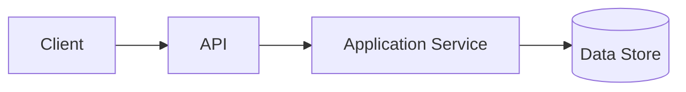

# [PROJECT OR FEATURE] — Technical Specification

**Status:** [Draft / In Review / Accepted / Superseded]  
**Owner:** [Responsible person or team]  
**Author:** [Author]  
**Created:** [YYYY-MM-DD]  
**Last updated:** [YYYY-MM-DD]  
**Related issue(s):** [Links or IDs]  
**Related ADR(s):** [Links or IDs]

## 1. Summary

[Describe the proposed system or change in a concise paragraph. Identify the user or system need.]

## 2. Context and problem

### Current situation

[Describe the existing workflow, system or limitation.]

### Problem statement

[State the problem precisely. Include evidence where available.]

### Users and stakeholders

| User / stakeholder | Need or responsibility |
|---|---|
| [Role] | [Need] |

## 3. Goals and non-goals

### Goals

- [Measurable or verifiable goal.]

### Non-goals

- [Explicitly excluded capability.]

## 4. Requirements

### Functional requirements

| ID | Requirement | Priority | Acceptance evidence |
|---|---|---|---|
| FR-001 | [The system shall...] | [Must / Should / Could] | [Test, demo or inspection] |

### Non-functional requirements

| ID | Quality attribute | Requirement / target | Verification method |
|---|---|---|---|
| NFR-001 | [Security / performance / reliability / accessibility / maintainability] | [Specific requirement] | [How it will be checked] |

Avoid arbitrary numeric targets. Establish baselines and justify measurable thresholds.

## 5. Use cases and workflows

### Primary use case

- **Actor:** [Actor]
- **Preconditions:** [Conditions]
- **Trigger:** [Trigger]
- **Main flow:** [Ordered steps]
- **Alternative flows:** [Alternatives]
- **Failure flows:** [Errors and recovery]
- **Postconditions:** [Expected state]

## 6. Proposed architecture

### Component overview

[Describe components and responsibilities.]

### Component interactions

[Include a Mermaid diagram or link to an architecture diagram when useful.]

Replace this illustrative diagram with the actual proposed architecture.

### Technology choices

| Concern | Proposed choice | Rationale | Alternatives considered |
|---|---|---|---|
| [Concern] | [Technology] | [Reason] | [Alternatives] |

### Trust boundaries

[Identify users, services, networks, tenants and external dependencies. Explain where trust changes.]

## 7. Data design

### Entities and relationships

[Describe entities, keys, relationships, constraints and lifecycle.]

### Data classification

[Identify public, internal, confidential or sensitive data.]

### Retention and deletion

[Specify retention, deletion, backup and recovery requirements.]

### Migrations

[Explain schema migration and rollback strategy.]

## 8. API and integration contracts

For each endpoint, event or external integration, document:

- Contract name and version.
- Producer and consumer.
- Authentication and authorisation.
- Request and response schemas.
- Validation and error behaviour.
- Idempotency, retries, timeouts and rate limits where relevant.
- Compatibility and deprecation approach.

Link to OpenAPI or machine-readable schemas when available.

## 9. Security and privacy analysis

| Threat / abuse case | Impact | Mitigation | Verification |
|---|---|---|---|
| [Threat] | [Impact] | [Control] | [Test or review] |

Consider authentication, authorisation, input handling, injection, secrets, dependency risk, auditability, privacy, abuse and failure modes. Record residual risks.

## 10. Reliability and performance

[Describe expected load, critical paths, failure handling, availability needs, resource constraints and recovery behaviour. Define how any performance claim will be measured.]

## 11. User experience and accessibility

[Describe key screens or interactions, responsive behaviour, keyboard access, focus visibility, contrast and assistive-technology considerations.]

## 12. Testing strategy

| Test level | Scope | Required evidence |
|---|---|---|
| Unit | [Logic] | [Test report] |
| Integration | [Component boundaries] | [Test report] |
| Contract | [API / event compatibility] | [Test report] |
| End-to-end | [Critical user workflows] | [Test report] |
| Security | [Relevant abuse cases] | [Scan / test / review] |
| Performance | [Relevant workloads] | [Reproducible benchmark] |

## 13. Deployment and operations

[Document environments, configuration, secrets, migrations, health checks, monitoring, backup, rollback and operational ownership.]

## 14. Rollout and migration plan

[Describe stages, compatibility, data migration, feature flags, rollback triggers and communication.]

## 15. Acceptance criteria

- [ ] [Observable criterion]
- [ ] [Automated test passes]
- [ ] [Security and failure cases reviewed]
- [ ] [Documentation updated]
- [ ] [Evidence linked]

## 16. Risks, assumptions and dependencies

| Type | Description | Likelihood / impact | Mitigation or owner |
|---|---|---|---|
| [Risk / assumption / dependency] | [Details] | [Assessment] | [Action] |

## 17. Open questions

- [Question, owner and target decision date.]

## 18. Decision record

[Summarise the accepted design decisions. Create an ADR for decisions with long-term architectural consequences.]

## 19. References

- [Relevant documentation, research, standards, issues and repositories.]
